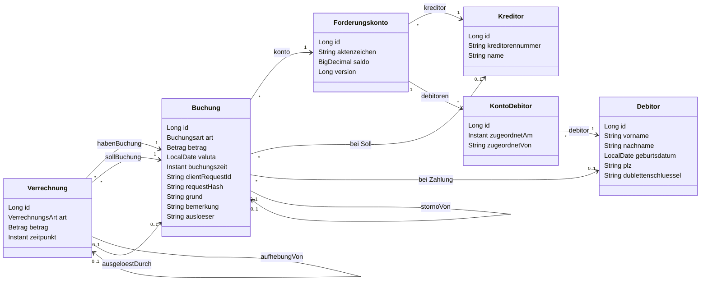

# Buchungsservice

Kleiner Buchungsservice für Forderungskonten, entstanden als Case Study für Riverty (Team Cosima Accounting). Nur Backend: Java 21, Spring Boot 4, REST-API.

Der Service verwaltet Kreditoren, Debitoren und Forderungskonten. Er bucht Sollposten (Hauptforderung, Zinsen, Gebühren) und Zahlungen und verrechnet Zahlungen nach **§ 367 BGB**. Er unterstützt Storno und Ausbuchung, und er prüft die Konsistenz eines Kontos. Buchungen und Verrechnungen sind unveränderlich (append-only): Korrekturen entstehen ausschließlich als neue Datensätze.

**Inhalt:** [Schnellstart](#schnellstart) · [Tests](#tests) · [Architektur](#architektur) · [Fachmodell](#fachmodell) · [Verrechnungsreihenfolge](#verrechnungsreihenfolge-nach--367-bgb) · [Datenbank](#datenbank-h2-und-postgresql) · [Bekannte Grenzen](#bekannte-grenzen) · [Annahmen](#annahmen) · [Nächste Schritte](#nächste-schritte) · [KI-Nutzung](#ki-nutzung)

## Schnellstart

Voraussetzung: JDK 21 oder neuer. Maven ist nicht nötig, der Maven Wrapper ist enthalten.

```sh
# Anwendung starten (H2-Datei unter ./data)
./mvnw spring-boot:run

# Mit Demo-Daten (Konto DEMO-0001 mit zwei Debitoren und drei Sollposten)
./mvnw spring-boot:run -Dspring-boot.run.profiles=demo
```

Unter Windows (PowerShell) lautet der Demo-Start `./mvnw spring-boot:run "-Dspring-boot.run.profiles=demo"`.

| Was | URL |
|---|---|
| Swagger UI | http://localhost:8080/swagger-ui.html |
| OpenAPI-Dokument | http://localhost:8080/v3/api-docs |
| H2-Konsole | http://localhost:8080/h2-console (Benutzer `sa`, Passwort leer, JDBC-URL siehe unten) |

JDBC-URL für die H2-Konsole, identisch mit `application.yml`:

```
jdbc:h2:file:./data/buchungsservice;MODE=PostgreSQL;DATABASE_TO_LOWER=TRUE;DEFAULT_NULL_ORDERING=HIGH;AUTO_SERVER=TRUE
```

**Demo-Walkthrough:** [`docs/demo.http`](docs/demo.http) enthält alle Requests in der Reihenfolge des Interviews: Beteiligte und Konto → Sollbuchung und Zahlung → Verrechnung und Storno. Die Datei lässt sich in IntelliJ direkt ausführen. Den kompletten Ablauf habe ich gegen die laufende Anwendung durchgespielt. Er endet mit Saldo 0.00 und Konsistenz OK. Die Erwartungswerte in den Kommentaren gelten für eine frische Datenbank. Vor einer Demo am besten das Verzeichnis `./data` löschen.

Die H2-Datei ist mit `AUTO_SERVER=TRUE` geöffnet. So kann die H2-Konsole parallel zur laufenden Anwendung auf dieselbe Datenbank zugreifen. Die Konsole ist nur für die lokale Entwicklung gedacht und wäre in Produktion abgeschaltet.

## Tests

```sh
./mvnw verify
```

`verify` läuft ohne Compiler-Warnungen durch (`-Xlint:all,-processing`, `failOnWarning`; ausgenommen ist nur die Meta-Warnung `processing`, weil Lombok als einziger Annotation-Processor fremde Annotationen nicht beansprucht). Der Testlauf umfasst:
- **Unit-Tests** für Domain-Werttypen: `Betrag`, Dublettenschlüssel, Buchungsart.
- **Service-Tests** gegen eine H2-In-Memory-Datenbank: Verrechnung nach § 367, Storno, Ausbuchung, Konsistenz, Idempotenz, parallele Zugriffe. Sie laufen bewusst mit echter Datenbank, damit Verrechnung, Persistenz, Constraints und Sperren gemeinsam geprüft werden.
- **REST-Integrationstests** mit MockMvc, darunter ein durchgehender Interview-Flow nur über HTTP.
- **Architekturtests** mit ArchUnit.

Alle Tests nutzen eine verstellbare Test-Clock und laufen dadurch deterministisch. Der Coverage-Report liegt nach dem Lauf unter `target/site/jacoco/index.html`.

## Setup für Mitwirkende

Den versionierten Pre-Push-Hook aktivieren. Er führt vor jedem Push `./mvnw verify` aus und bricht den Push bei Fehlern ab:

```sh
git config core.hooksPath .githooks
```

## Architektur

```
de.riverty.buchungsservice
 ├─ api            Controller, Request/Response-Records, Fehlerbehandlung (ProblemDetail)
 ├─ config         Clock, Validierung, OpenAPI, Demo-Daten
 └─ internal
     ├─ domain       Entitäten, Value Objects (Betrag, Dublettenschlüssel), Enums, fachliche Exceptions
     ├─ service      Anwendungslogik, Transaktionen, Verrechnung nach § 367, Lesemodelle
     └─ persistence  Spring-Data-Repositories
```

Diese Regeln erzwingt ein ArchUnit-Test (`ArchitekturTest`):
- `internal` kennt `api` nicht.
- `api` greift nicht auf `persistence` zu, Controller arbeiten also nur über Services.
- `persistence` kennt `service` nicht, `domain` hängt von keiner anderen Schicht ab.
- Keine `Map` als Fach- oder API-Typ.

Weitere Designentscheidungen:
- **Fachlogik in der Domain:** `Buchungsart` kennt Soll/Haben und den Tilgungsrang nach § 367. `Forderungskonto` schreibt den Saldo fort. `Betrag` rundet kaufmännisch und lehnt Werte ≤ 0 ab.
- **Lombok nur sparsam:** auf Entities nur `@Getter` und `@NoArgsConstructor(access = PROTECTED)`, Erzeugung über statische Factories, `equals`/`hashCode` über die Id. `Buchung` und `Verrechnung` sind `@Immutable` und haben keine Setter. DTOs und Value Objects sind Records.
- **Schema ausschließlich über Flyway**, Hibernate validiert nur (`ddl-auto=validate`). Constraints in der Datenbank sichern zusätzlich ab: Unique, CHECK `betrag > 0`, art-abhängige Pflichtfelder, ein Storno je Buchung.
- **Zeit über eine injizierte `Clock`:** Die Valuta ist ein `LocalDate`, die Buchungszeit ein `Instant` in UTC.

## Fachmodell



Eindeutig sind: Kreditorennummer, Dublettenschlüssel, Aktenzeichen, `clientRequestId`.

| Buchungsart | Seite | Bemerkung |
|---|---|---|
| HAUPTFORDERUNG, ZINSEN, GEBUEHREN | Soll | speichert den Kreditor des Kontos |
| ZAHLUNG | Haben | speichert den zahlenden Debitor |
| AUSBUCHUNG | Haben | immer der gesamte offene Rest, erzeugt nie Guthaben |
| STORNO | Gegenseite des Originals | gleicher Betrag, verweist über `stornoVon` auf das Original |

Beträge sind **nie negativ**, die Richtung ergibt sich aus der Buchungsart. Der Saldo ist Σ Soll − Σ Haben, Stornos werden gegengerechnet. Ein negativer Saldo bedeutet Guthaben.

**Verrechnungen werden gespeichert**, nicht nur berechnet. Jede Zuordnung einer Zahlung oder Ausbuchung zu einem Sollposten ist ein eigener Datensatz. Ein Storno löscht keine Verrechnung, sondern erzeugt eine `AUFHEBUNG`, die auf die Original-Verrechnung und auf die auslösende Storno-Buchung verweist. Daraus abgeleitet werden:
- **Offener Betrag eines Sollpostens** = Betrag − Σ Verrechnungen + Σ Aufhebungen. Ein stornierter Posten ist nicht offen.
- **Guthaben einer Zahlung** = Betrag − netto verrechneter Betrag. Ist die Zahlung storniert, ist das Guthaben 0.
- **Guthaben pro Debitor** = Σ Guthaben seiner Zahlungen auf diesem Konto.

### Verrechnungsreihenfolge nach § 367 BGB

1. **Gebühren (Kosten) → Zinsen → Hauptforderung**
2. Innerhalb einer Art: älteste Valuta zuerst, dann Buchungszeit, dann Id.
3. Wird vorhandenes Guthaben verteilt: älteste Zahlung (Valuta) zuerst.

**Abweichung von der Folie:** Die Aufgabenstellung nennt als Beispiel die Reihenfolge Hauptforderung → Zinsen → Gebühren. Der Service folgt bewusst der gesetzlichen Reihenfolge aus § 367 Abs. 1 BGB: Eine Leistung wird zuerst auf die Kosten, dann auf die Zinsen und zuletzt auf die Hauptleistung angerechnet. Annahme: Inkassogebühren gelten als Kosten im Sinne von § 367. Die Reihenfolge steckt an einer Stelle (`Buchungsart.tilgungsrang()`) und ließe sich bei anderer fachlicher Vorgabe leicht ändern.

Verrechnet wird bei jedem Zahlungseingang automatisch, und zwar nur die neue Zahlung. Explizit verteilt `POST /api/konten/{id}/verrechnung` vorhandenes Guthaben, etwa wenn nach einer Überzahlung neue Zinsen gebucht werden.

## Datenbank: H2 und PostgreSQL

Die Anwendung nutzt bewusst **H2 im Dateimodus** (`MODE=PostgreSQL`). Sie startet damit ohne Docker und ohne weitere Infrastruktur, und die Daten bleiben über Neustarts erhalten. Tests laufen gegen eine eigene H2-In-Memory-Datenbank.

In Produktion käme **PostgreSQL** zum Einsatz. Durch Flyway und `MODE=PostgreSQL` ist der Wechsel klein:
- PostgreSQL-Treiber statt H2 und eine andere Datasource-Konfiguration.
- Die Migrationen sind portabel geschrieben (`GENERATED BY DEFAULT AS IDENTITY`, `NUMERIC(15,2)`, `TIMESTAMP WITH TIME ZONE`, CHECK-Constraints).
- Für Integrationstests gegen echtes PostgreSQL böten sich Testcontainers an.

## Konfiguration

Die Zugangsdaten der lokalen H2-Datenbank (`sa`, leeres Passwort) stehen der Einfachheit halber im Klartext in `application.yml`. In produktivem Code stünden Credentials natürlich nicht im Klartext im Repository. Sie würden über Umgebungsvariablen oder einen Secret-Store (z. B. Vault, Kubernetes Secrets oder einen Cloud Secrets Manager) injiziert.

## Codequalität: SonarQube Cloud

Für die statische Analyse ist SonarQube Cloud vorgesehen, die Einbindung in die CI folgt als eigener Schritt. Das ist hier kostenlos, weil das Repository öffentlich ist. Für privaten Code in Produktion wäre ein kostenpflichtiger Plan oder ein selbst gehosteter SonarQube Server nötig.

## Bekannte Grenzen

Diese Punkte sind bewusst nicht umgesetzt. Für eine Case Study stehen Aufwand und Nutzen in keinem guten Verhältnis, in einem produktiven System würden sie angegangen.

- **Beträge mit extremem Exponenten:** Ein Betrag wie `1e1000000000` passiert `@Positive` und das Längenlimit von Jackson, weil der Text kurz ist. `Betrag` rundet zuerst auf zwei Nachkommastellen und prüft danach die Obergrenze. Das Runden einer Zahl mit Milliarden Stellen kann sehr viel CPU und Speicher kosten. Abhilfe wäre, vor dem Runden die Größenordnung zu prüfen oder die erlaubte Skala schon beim JSON-Parsen zu begrenzen.
- **Keine `feldfehler` bei Typfehlern:** Bei `"betrag": "abc"`, einem unbekannten Enum-Wert oder einem falschen Datumsformat kommt 400 mit allgemeinem Text, aber ohne Feldangabe.
- **Kein `Location`-Header** bei 201-Antworten.
- **Keine Paginierung:** Weder die Suche noch die Buchungshistorie sind paginiert.
- **Kontoansicht ohne Snapshot:** Saldo, Guthaben und Historie werden in einer Lesetransaktion, aber mit getrennten Abfragen und ohne Sperre gelesen. Wird parallel gebucht, kann die Ansicht einen Zwischenstand zeigen. Die Konsistenzprüfung und alle schreibenden Vorgänge sind davon nicht betroffen.

## Annahmen

### Verrechnung
- Reihenfolge nach § 367 BGB mit Begründung der Abweichung von der Folie: siehe [Verrechnungsreihenfolge](#verrechnungsreihenfolge-nach--367-bgb). Durch den Tie-Breaker über die Id ist die Reihenfolge immer eindeutig.
- **Die Valuta ist kein Stichtag:** Sie bestimmt nur die Reihenfolge. Auch Posten mit einer Valuta in der Zukunft werden sofort von Zahlungen bedient, und Zahlungen mit Zukunftsvaluta werden sofort verrechnet.
- **Gesamtschuld:** Jeder dem Konto zugeordnete Debitor haftet für alle Posten. Guthaben jedes Debitors darf deshalb auf alle offenen Posten des Kontos verteilt werden.
- **Guthaben gilt pro Konto:** Ein Guthaben, das ein Debitor auf Konto A hat, wird nie auf Konto B verrechnet, auch wenn er beiden Konten zugeordnet ist.
- Die **automatische Verrechnung** bei Zahlungseingang verteilt nur die neue Zahlung. Vorhandenes Guthaben wird nur explizit verteilt, dann die Zahlung mit der ältesten Valuta zuerst, danach die mit der früheren Buchungszeit, danach die mit der kleineren Id.

### Zahlung
- Eine Zahlung ist immer einem Debitor zugeordnet, der dem Konto zugeordnet sein muss.
- Eine Überzahlung bleibt als Guthaben beim zahlenden Debitor.
- Eine Zahlung auf ein Konto ohne offene Posten ist erlaubt und wird vollständig Guthaben dieses Debitors.

### Sollbuchung
- Ein Forderungskonto hat immer genau einen Kreditor, der nicht geändert werden kann. Jede Sollbuchung speichert zusätzlich die Referenz auf diesen Kreditor. So ist die geforderte Zuordnung jeder Sollbuchung zu einem Kreditor direkt an der Buchung nachvollziehbar.

### Storno
- Die Valuta einer Storno-Buchung ist die **Valuta der Originalbuchung**. Original und Storno fallen in der Historie zeitlich zusammen.
- Eine Sollbuchung, auf die bereits eine Ausbuchung verrechnet ist, kann nicht storniert werden (422). Zuerst muss die Ausbuchung storniert werden, denn eine Ausbuchung darf nie Guthaben erzeugen.
- Ein Storno hebt **alle** aktiven Verrechnungen der Originalbuchung auf, egal ob sie aus der automatischen Verrechnung bei Zahlungseingang stammen oder aus der expliziten Verrechnung.
- Eine Zahlung kann auch nach einer Ausbuchung storniert werden. Aufgehoben werden nur die Verrechnungen dieser Zahlung, die Ausbuchung bleibt bestehen. Die Posten, die die Zahlung bedient hatte, sind wieder offen, und der Saldo wird wieder positiv. Sie können erneut bezahlt oder ausgebucht werden.
- Die Storno-Buchung muss zum Konto im Pfad gehören. Die Id einer Buchung eines anderen Kontos wird als Regelverstoß abgelehnt (422).

### Ausbuchung
- Ausgebucht wird immer der gesamte offene Rest des Kontos. Erfasst werden alle offenen Posten, **unabhängig von ihrer Valuta**.
- Die Valuta einer Ausbuchung ist das aktuelle Datum aus der injizierten `Clock`, bestimmt in **UTC**. Das System verwendet weltweit einheitlich UTC.
- Hat ein Debitor noch Guthaben, während Posten offen sind, wird die Ausbuchung abgelehnt (422). Zuerst muss das Guthaben über `POST /api/konten/{id}/verrechnung` verteilt werden. Sonst würde eine Forderung abgeschrieben, die mit vorhandenem Geld bezahlt werden kann.

### Explizite Verrechnung
- Gibt es nichts zu verteilen (kein Guthaben oder keine offenen Posten), ist der Aufruf ein No-op und liefert eine leere Liste mit 200. So bleibt der Endpunkt idempotent.

### Beteiligte und Konto
- Der Dublettenschlüssel eines Debitors besteht aus den getrennt normalisierten Feldern. „Anna Lena / Schmidt“ und „Anna / Lena Schmidt“ sind daher verschiedene Personen. Normalisiert wird nur wie spezifiziert (trim, lowercase, Umlaute, ß, Leerzeichen). Akzente und Bindestriche bleiben unverändert. Der Feldtrenner `|` und das Maskierungszeichen `\` werden in den Feldwerten maskiert. So können auch Namen, die selbst ein `|` enthalten, keine falsche Dublette erzeugen.
- Kreditorennummer und Aktenzeichen werden getrimmt, Groß- und Kleinschreibung bleibt erhalten. Ein doppeltes Aktenzeichen liefert wie bei Kreditor und Debitor 409 mit der Id des vorhandenen Kontos.
- Wird ein Debitor einem Konto zugeordnet, dem er schon zugeordnet ist, antwortet der Service mit 409 und `vorhandeneId` = Id des Debitors.
- Wird bei der Kontoanlage direkt ein Debitor zugeordnet, steht in `zugeordnetVon` der Wert „Kontoanlage“, weil der Request dafür kein Feld hat.

### REST-API: Antworten
- Sollbuchung, Zahlung, Storno und Ausbuchung antworten mit **201** bei einer neuen Buchung und mit **200** beim Replay (gleiche `clientRequestId`, gleicher Inhalt). Der Body ist in beiden Fällen dieselbe Buchung.
- `POST /api/konten/{id}/verrechnung` antwortet immer mit 200 und der Liste der neu erzeugten Verrechnungen, auch wenn die Liste leer ist. Es entsteht keine einzeln adressierbare Ressource.
- Format: Felder mit dem Wert `null` werden weggelassen. Beträge sind JSON-Zahlen mit genau zwei Nachkommastellen (`100.00`, `-20.00`). Zeitstempel sind ISO-Instants in UTC, `valuta` und `geburtsdatum` ISO-Daten (`yyyy-MM-dd`).
- Die Konto-Antwort bei Anlage und Suche enthält nur die `debitorIds`. Die vollständigen Debitor-Daten mit Guthaben und Zuordnung liefert die Kontoansicht `GET /api/konten/{id}`.
- Sortierung der Listen:
  - Suche: nach Id
  - Buchungshistorie: nach Valuta, dann Buchungszeit, dann Id
  - `/offene-posten`: in der Verrechnungsreihenfolge nach § 367
  - `/verrechnungen`: nach Id
- 201-Antworten setzen keinen `Location`-Header (siehe „Bekannte Grenzen“). Die angelegte Ressource steht im Body.

### REST-API: Suche
- `GET /api/konten?aktenzeichen=&kreditorennummer=`: Mindestens ein nicht leerer Parameter ist Pflicht, sonst gibt es 400 ohne `feldfehler`. Die Pflicht prüft der Service selbst, nicht nur der Controller. So kann auch ein anderer Aufrufer keine ungefilterte Liste aller Konten abrufen.
- Ein leerer Parameter gilt als nicht angegeben. `?aktenzeichen=&kreditorennummer=K-1` sucht deshalb nur nach der Kreditorennummer.
- Sind beide Parameter angegeben, werden sie mit UND verknüpft. Die Werte werden getrimmt und müssen exakt passen, Groß- und Kleinschreibung zählt. Kein Treffer ergibt 200 mit leerer Liste.

### REST-API: Validierung und Fehler
- Fehler werden einheitlich als `ProblemDetail` (RFC 9457, `application/problem+json`) geliefert, mit `type`, `title`, `status`, `detail` und `instance`.
  - Fachliche Kategorien in `type`: `urn:buchungsservice:validierung` (400), `…:nicht-gefunden` (404), `…:duplikat` (409), `…:konflikt` (409), `…:fachregel` (422).
  - Technische Kategorien: `urn:buchungsservice:anfrage` für sonstige Client-Fehler (z. B. 405, 406, 415) und `urn:buchungsservice:intern` für 500. Bei 500 enthält die Antwort nur einen neutralen Text, die Details stehen im Error-Log.
  - Bei einem Duplikat gibt es zusätzlich `vorhandeneId`, bei Validierungsfehlern eine Liste `feldfehler` mit `{feld, meldung}`.
- Bean Validation prüft vor jeder fachlichen Prüfung. Ein ungültiger Body an ein nicht existierendes Konto ergibt daher 400, nicht 404.
- Pflichtfelder über die im Auftrag genannten hinaus: `debitorId` bei der Zahlung, `kreditorId` bei der Kontoanlage, `debitorId` und `zugeordnetVon` bei der Zuordnung, `plz` und `art`. Fehlen sie, gibt es 400.
- `waehrung` muss exakt `EUR` lauten, `eur` oder `USD` ergeben 400.
- Die Sollbuchung nimmt als `art` nur `HAUPTFORDERUNG`, `ZINSEN` oder `GEBUEHREN` an (eigenes API-Enum `Sollart`). Jeder unbekannte Enum-Wert ergibt 400, etwa `ZAHLUNG` als Sollart oder `FOO` als Grund. Swagger zeigt nur die gültigen Werte an. Die fachliche Prüfung im Service bleibt als zweite Absicherung.
- Storno und Ausbuchung: Fehlen `grund` oder `ausloeser`, gibt es über die API 400 (Bean Validation). Im Service selbst gilt 422 als zweite Absicherung. Beide Prüfungen laufen vor der Idempotenz- und der Kontoprüfung, eine abgelehnte `clientRequestId` bleibt also frei.
- Ebenfalls 400 (`validierung`): unlesbares JSON, fehlender Body, falsches Datumsformat, nicht-numerische Pfad-Id (z. B. `/api/konten/abc`). Diese Fälle haben keine `feldfehler` (siehe „Bekannte Grenzen“).
- Beträge:
  - Ein Betrag, der nach dem Runden 0.00 ergibt (z. B. 0.004), ist aus Client-Sicht eine ungültige Eingabe wie 0 oder ein negativer Betrag und ergibt 400.
  - Beträge haben höchstens 13 Vorkommastellen, passend zur Spalte `NUMERIC(15,2)`. Größere Beträge ergeben ebenfalls 400. Entscheidend ist der gerundete Wert: 9999999999999.995 wird abgelehnt.
  - In beiden Fällen heißt der Eintrag in `feldfehler` `betrag`.
- Textfelder haben eine Höchstlänge passend zum Datenbankschema (`@Size`). Zu lange Werte ergeben 400 mit `feldfehler` statt eines Datenbankfehlers. Geprüft wird der Rohwert vor dem Trimmen.

  | Feld | Höchstlänge |
  |---|---|
  | Kreditorennummer, Aktenzeichen | 50 |
  | Name des Kreditors | 200 |
  | Vor- und Nachname, `zugeordnetVon`, `ausloeser`, `clientRequestId` | 100 |
  | PLZ | 10 |
  | Bemerkung | 500 |
- `@Past` für das Geburtsdatum vergleicht mit dem Datum der injizierten `Clock` (UTC). Ein Geburtsdatum „heute“ ergibt 400.
- Eine Zahlung mit einer nicht existierenden `debitorId` ergibt 404. 422 gibt es, wenn der Debitor existiert, aber dem Konto nicht zugeordnet ist.
- Bei 409 wegen paralleler Änderung oder Lock-Timeout ist das `detail` ein neutraler Text. Die technische Ursache wird geloggt.

### Demo-Daten (Profil `demo`)

| Objekt | Werte |
|---|---|
| Kreditor | `K-DEMO`, „Musterstadt Inkasso GmbH“ |
| Debitor | Max Mustermann, geb. 14.03.1985, PLZ 10115; zugeordnet bei der Kontoanlage („Kontoanlage“) |
| Debitor | Erika Mustermann, geb. 22.08.1987, PLZ 10115; zugeordnet mit `zugeordnetVon` „demo“ |
| Konto | `DEMO-0001` |
| Sollbuchungen | Hauptforderung 1.000,00 € (Valuta 15.01.2026), Gebühren 30,00 € (01.02.2026), Zinsen 50,00 € (01.03.2026) |
| `clientRequestId`s | `demo-hauptforderung`, `demo-gebuehren`, `demo-zinsen` |
| Saldo | 1.080,00 € |

- Bewusst gibt es keine Zahlung, die wird in der Demo live gebucht. Ohne Profil `demo` und im Testprofil wird nichts geladen.
- Der Lader ist idempotent und läuft bei einem Neustart mit der Datei-DB ohne Duplikate. Er arbeitet ausschließlich über die Services:
  - Vorhandene Datensätze werden über die Duplikat-Antwort wiederverwendet.
  - Sollbuchungen laufen über feste `clientRequestId`s (Replay).
  - Existiert `DEMO-0001` bereits ohne Max, ordnet der Lader ihn mit `zugeordnetVon` „demo“ zu.

### Valuta
- Valuten dürfen in der Zukunft liegen und vom Buchungstag abweichen.
- Die Valuta ist ein `LocalDate`, also ein fachliches Datum ohne Uhrzeit und ohne Zeitzone. Die Buchungszeit ist dagegen ein `Instant` in UTC. Beide Werte sind bewusst nicht deckungsgleich: Das UTC-Datum der Buchungszeit kann vom lokalen Geschäftstag abweichen. Eine Buchung um 00:30 Uhr deutscher Zeit (MEZ) hat zum Beispiel die Buchungszeit 23:30 UTC des Vortags. Wo der Service selbst eine Valuta bestimmt (Ausbuchung), leitet er sie aus der UTC-Uhr ab. In einem produktiven System müsste festgelegt werden, welche Zeitzone den Geschäftstag bestimmt, etwa pro Mandant.
- Fachliche Zeitstempel (Buchungszeit, Zuordnungszeitpunkt, Verrechnungszeitpunkt) werden auf Mikrosekunden gekürzt, die Genauigkeit der Datenbankspalte. So sind gespeicherter und zurückgegebener Wert identisch.

### Konsistenzprüfung
Geprüft werden zwei Invarianten:
1. Der gespeicherte Saldo entspricht dem Saldo aus allen Buchungen.
2. Die Verrechnungen sind stimmig:
   - Kein Sollposten ist überbezahlt: Der netto verrechnete Betrag (Verrechnungen minus Aufhebungen) ist höchstens so groß wie der Betrag des Postens.
   - Keine Haben-Buchung (Zahlung oder Ausbuchung) ist überverteilt.
   - Kein netto verrechneter Betrag ist negativ (mehr Aufhebungen als Verrechnungen). Geprüft wird je Soll- und je Haben-Buchung. Eine einzelne fehlerhafte Aufhebung erzeugt daher zwei Abweichungen, je eine auf beiden Seiten.

Die ursprünglich geplante Invariante „Saldo = Σ offene Posten − Σ Guthaben“ wurde bewusst durch diese direkten Prüfungen ersetzt. Sie benennen die betroffene Buchung konkret und sind einfacher nachzuvollziehen. Eine Abweichung wird mit erwartetem Wert, Istwert und Differenz (Ist − Erwartet) gemeldet und zusätzlich als Error geloggt.

### Idempotenz
- Der Request-Hash umfasst neben den fachlichen Feldern auch den Operationstyp, die Konto-Id und bei Storno die Id der stornierten Buchung. Dieselbe `clientRequestId` auf einem anderen Konto oder für eine andere Operation führt daher zu 409.
- Ein Replay hat Vorrang vor fachlichen Prüfungen. Ein identisch wiederholtes Storno liefert die Original-Storno-Buchung und keinen Doppelstorno-Konflikt.
- Welche Felder in den Hash eingehen:

  | Operation | Felder |
  |---|---|
  | Sollbuchung | Operation, Konto, Art, gerundeter Betrag, Valuta |
  | Zahlung | Operation, Konto, Debitor, gerundeter Betrag, Valuta |
  | Storno | Operation, Konto, Buchung, Grund, Bemerkung, Auslöser |
  | Ausbuchung | Operation, Konto, Grund, Bemerkung, Auslöser |

  `12` und `12.00` ergeben deshalb denselben Hash. Jedes Feld geht längenkodiert ein, damit Feldgrenzen eindeutig bleiben.
- Ein ungültiger Betrag wird schon vor der Idempotenzprüfung abgelehnt. Er kann nie gespeichert worden sein, ein Replay ist also ausgeschlossen.

### Parallele Zugriffe
- **Pessimistisches Locking pro Konto:** Jede Buchung (Sollbuchung, Zahlung, Storno, Ausbuchung) und jede explizite Verrechnung lädt das Forderungskonto mit einer Schreibsperre (`PESSIMISTIC_WRITE`, also `SELECT … FOR UPDATE`). Parallele Änderungen am selben Konto laufen dadurch nacheinander ab: Zahlen D1 und D2 gleichzeitig, wartet die zweite Zahlung kurz und wird danach ebenfalls erfolgreich gebucht. Saldo und Verrechnungen bleiben konsistent, weil jede Buchung den Stand der vorherigen sieht.
- **`@Version` als Absicherung:** Das Konto behält sein Versionsfeld. Würde ein veralteter Stand geschrieben, etwa durch einen künftigen Codepfad ohne Sperre, schlägt das Optimistic Locking an und der Service antwortet mit 409.
- **Abwägung:** Pessimistisches Locking serialisiert nur Zugriffe auf **dasselbe** Konto, verschiedene Konten laufen weiter parallel. Bei sehr vielen gleichzeitigen Buchungen auf einem einzelnen Konto würden die Requests warten. Für Forderungskonten ist das realistisch unkritisch. Ohne Sperre müsste der Client bei jedem Konflikt erneut senden, und das ist für Zahlungseingänge unpraktisch.
- Auch die Idempotenz profitiert davon: Ein paralleler Request mit derselben `clientRequestId` wartet auf die Sperre und findet danach die bereits committete Originalbuchung (Replay). Kommt dieselbe `clientRequestId` parallel auf einem anderen Konto, greift der Unique-Constraint. Der Service liest dann neu und antwortet mit Konflikt (409), weil die Konto-Id in den Request-Hash eingeht.
- Dauert das Warten länger als das Lock-Timeout der Datenbank, antwortet der Service mit 409. Der Client kann den Request mit derselben `clientRequestId` gefahrlos wiederholen.
- Parallele Anlage von Stammdaten (Kreditor, Debitor, Konto) mit demselben eindeutigen Merkmal: Der Unique-Constraint der Datenbank entscheidet, der zweite Aufruf erhält 409 mit der Id des Vorhandenen.
- Ein Test mit zwei Threads stellt sicher, dass zwei gleichzeitige Zahlungen beide gebucht werden und der Saldo stimmt.

### Prüfreihenfolge
- **Zahlung:** `debitorId` angegeben (über die API per Bean Validation 400, im Service selbst 422 als zweite Absicherung) → Konto existiert (404) → Debitor existiert (404) → Debitor dem Konto zugeordnet (422).
- **Storno:** Konto existiert (404) → Buchung existiert (404) → Buchung gehört zum Konto (422) → nicht bereits storniert (409) → kein Storno eines Stornos (409) → keine aktive Ausbuchungs-Verrechnung (422).
- **Ausbuchung:** Sind keine Posten offen, meldet der Service „nichts offen“ (422). Das wird vor der Guthabenprüfung geprüft.

### Gespeicherte Stammdaten
- Namen und PLZ werden unverändert gespeichert. Normalisiert wird nur der Dublettenschlüssel, getrimmt nur Kreditorennummer und Aktenzeichen.

## Nächste Schritte

- **Ausbuchung einzelner Posten** statt nur des gesamten offenen Rests.
- **Debitor vom Konto entfernen** (mit Historie der Zuordnungen).
- **Fuzzy-Dublettenprüfung** für Debitoren (Tippfehler, Namensvarianten), z. B. mit phonetischen Verfahren oder Ähnlichkeitsmaßen.
- **Zinsberechnung** (Verzugszinsen) statt manuell gebuchter Zinsen.
- **Authentifizierung und Autorisierung**. Der Auslöser von Storno, Ausbuchung und Zuordnung käme dann aus dem Security-Context statt aus dem Request.
- **PostgreSQL** als Datenbank, Integrationstests mit Testcontainers.
- **Paginierung** von Suche und Buchungshistorie.
- **Domain Events / Outbox**, um Buchungen zuverlässig an nachgelagerte Systeme (z. B. Hauptbuch, Reporting) zu melden.

## KI-Nutzung

Bei der Entwicklung habe ich KI eingesetzt: Claude als Sparringspartner für das Design und Claude Code für die Umsetzung, mit getrennten Rollen für Product Manager, Tester, Coder und Reviewer. Jede Stufe habe ich selbst reviewt und freigegeben. Vorgehen, meine fachlichen Entscheidungen und die Stellen, an denen ich KI-Vorschläge korrigiert oder verworfen habe, stehen in [`aiprompts.md`](aiprompts.md).
